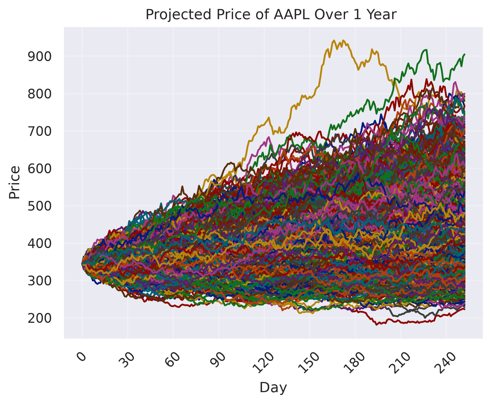
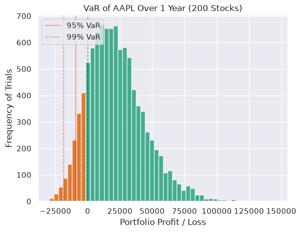

# Monte-Carlo 

A repository deticated to the exploration and application of Monte Carlo and similar topics. Applications include computing, mathematics, phsics, and finance. 

## Monte Carlo Stock Simulation

This project looks at historical stock prices from Apple (AAPL) over the past year to run Geometric Brownian Motion Monte-Carlo for N paths. This allows us to develop a distribution of potential future prices of a given stock for reasons like risk analysis. 

In the future, I'd like to expand upon this and have a bot make real-time decisions. A way this could work is going back 2 years and running monte carlo for 1 and test the bot on the next year.

$$
S_t = S_0 \exp \left( \left( \mu - \frac{\sigma^2}{2} \right) t + \sigma W_t \right)
$$

### Performance Results 

#### Performance (Pre-Optimized): 

10,000 Paths: 
- Time: 766,877 ns 
- GFLOPS: 0.082 GFLOPS 

1,000,000 Paths: 
- Time: 65,072,346 ns 
- GFLOPS: 0.097 GFLOPS 

#### Performance (Optimized): 

10,000 Paths: 
- Time: 398,809 ns 
- GFLOPS: 0.158 GFLOPS 

1,000,000 Paths: 
- Time: 39,146,595 ns 
- GFLOPS: 160.9 GFLOPS 

Note, the performance is significantly slower than if I just did the final output but since I'm manefesting the entire matrix, this forces us to manage a 1 GB matrix. 

As you can see, the optimizations allowed us to significantly increase our performance and scale the workload in a nearly linear fashion. The optimization came down to transposing the output matrix to allow the threads to access memory in an aligned manner. This nets us a 66% increase in speed over 1,000,000 paths. 

### Analysis 

 

Beyond useful information, I find the above image really cool to look at. This shows a rather consistent trend of an increase in the price of AAPL which is of course good for any investors. 

 

From the image above, you can see that the distribution of the final prices of AAPL is skewed to the right indicating a rather optimistic future. The vertical lines indicate the Value at Risk (VaR) which tells you the chance of losing money. For example, say an investor bought 200 stocks a year ago. There is a 5% chance that they would have lost $9,000 and a 1% chance that they lost $19,000. 

## PI Estimation 

I implemented this to get a good understanding of how Monte Carlo works in a base sense and how it can be done in CUDA. I added a triton version to analyze the error as the number of trials increased. I also wanted to compare CUDA vs Triton in terms of accuracy. 

### Results 

$$
\text{Error} = \left( \frac{|\text{estimate} - \text{baseline}|}{\text{baseline}} \right) \times 100
$$

#### CUDA 

- Threads per Block: 215
- Blocks per Grid: 4096 
- Trials per Thread: 10,000
- Number of Trials: 10,485,760,000

Results: 

- Time: 78,818,925 ns
- Error: 0.00012%

#### Triton

- Grid Size: 4096
- Block Size: 256
- Trials per Thread: 10,000
- Number of Trials: 10,485,760,000

Results: 

- Time: 494,546,786 ns
- Error: 0.00028%

While Triton is excellent for experimentation and deploying models such as LLMs, it did seem to lag behind raw CUDA in terms of performance and accuracy as CUDA was over 6x faster. Though this comparison isn't entirely fair as Triton executes in a slightly more sequential manner thats optimized for different workloads as stated earlier.

<Figure size 640x480 with 1 Axes>

